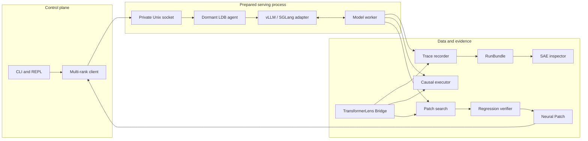

# LDB Architecture v0.1

## Scope

LDB is a CLI-first runtime debugger for model internals. Version 0.1 includes a
single-process Hugging Face causal-analysis path and prepared in-process agents for
SGLang and vLLM workers. The CLI and target runtime communicate through a versioned
local protocol without coupling artifact formats to a serving engine.

Out of scope for v0.1:

- web interfaces and application-level LLM observability;
- `torch.compile`, fused-kernel internals, and mid-kernel suspension;
- permanent weight editing;
- automatic sparse autoencoder training.

## Component map



## Runtime boundary

The core uses normalized hook names and must not depend on architecture-specific
classes. An adapter maps backend modules onto names such as:

```text
block.17.residual.pre
block.17.attention.output
block.17.attention.heads
block.17.mlp.output
block.17.residual.post
block.17.moe.router.logits
block.17.moe.expert.3.output
logits
```

A breakpoint may suspend execution only at a declared safe point. In eager mode,
safe points are module pre-hooks, module post-hooks, and token boundaries. LDB must
never imply that it can suspend execution inside an opaque CUDA kernel.

## Control and data planes

The multi-process design uses a versioned JSON-lines control protocol over a Unix
domain socket. Control messages carry commands, events, metadata, and tensor
references. Bulk tensors are stored outside the control channel.

Offline analysis uses TransformerLens 3.x `TransformerBridge` as its primary model
instrumentation layer. LDB normalizes stable Bridge hooks into its own artifact
schema and retains a native Transformers adapter as a narrow fallback. Version 0.1
also supports a prepared in-process agent controlled through a user-private Unix
domain socket and keeps these concepts separate:

- control: session commands and typed events;
- data: tensor files in a RunBundle;
- index: SQLite once cross-run querying is implemented.

See [runtime attachment](runtime-attachment.md) for the live protocol, runtime
plugin boundaries, and current eager-execution requirement.

## Evidence levels

Every finding must be classified as one of:

- `observed`
- `correlated`
- `attributed`
- `causally_tested`
- `replicated`

Only a successful intervention may promote a finding to `causally_tested`.

## Implementation order

1. RunBundle, normalized hook topology, real inference trace, and patch validation.
2. Out-of-process control of prepared vLLM and SGLang worker agents.
3. Interactive safe-point breakpoints and request-scoped live interventions.
4. Clean/corrupt replay, ablation, and activation patching.
5. Regression suites and minimal patch search.
6. CUDA Graph, SAE, and deeper MoE instrumentation.
